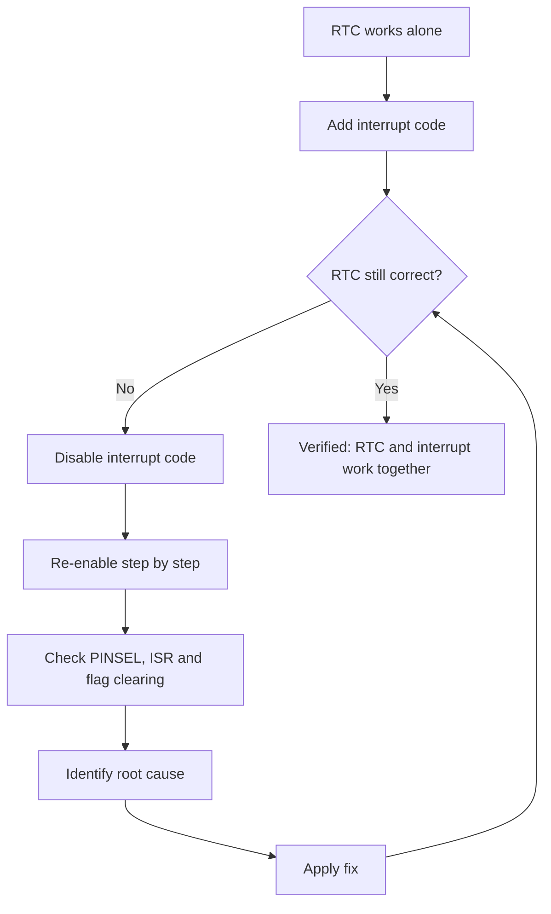
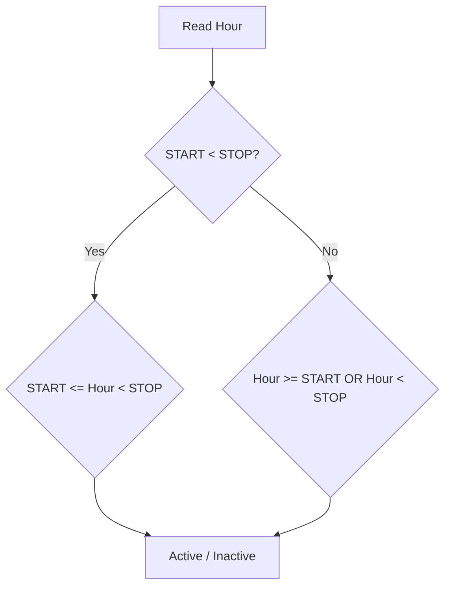
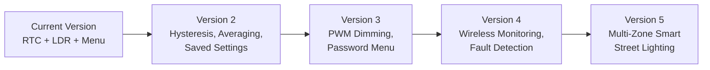

# 🧩 Challenges and Future Enhancements
### Adaptive Street Light Control Using Time and Environmental Illumination

This document records the development challenges of the LPC2148-based adaptive street light system and the improvements that can be made in future versions.

[⬅ Back to README](README.md)

---

## 📑 Table of Contents

- [🧩 Development Challenges](#-development-challenges)
- [📋 Challenge Summary](#-challenge-summary)
- [📝 Challenge Log Template](#-challenge-log-template)
- [🧠 Lessons Learned](#-lessons-learned)
- [🚀 Future Enhancements](#-future-enhancements)
- [🗺️ Enhancement Roadmap](#️-enhancement-roadmap)

---

## 🧩 Development Challenges

> Challenges 1 is based on an issue encountered during development. Challenges 2 to 8 describe the design considerations handled in the firmware. Fill in the **Root Cause** and **Final Verification** fields with your actual observations before publishing.

---

### Challenge 1 — RTC Behaviour Affected After Adding the Interrupt Code

| Item | Details |
|---|---|
| **Module** | `rtc.c`, `interrupt.c`, `main.c` |
| **Problem** | After the external-interrupt code was added for the configuration menu, the RTC time display stopped working reliably. |
| **Root Cause** | `<fill in: e.g. conflicting pin configuration, interrupt flag not cleared, RTC re-initialised on each menu entry, shared PINSEL setting overwritten>` |
| **Debugging Approach** | Tested the RTC with the interrupt code disabled, then re-enabled the interrupt step by step. Checked pin function-select registers, the ISR, and whether the RTC was being re-initialised. |
| **Solution** | `<fill in the change that fixed it>` |
| **Final Verification** | `<fill in: RTC keeps counting correctly with the interrupt enabled and after exiting the menu>` |

---

### Challenge 2 — Keeping the Interrupt Service Routine Short

| Item | Details |
|---|---|
| **Module** | `interrupt.c`, `main.c` |
| **Problem** | Running LCD, keypad and RTC operations directly inside the ISR would block other interrupts and make the system unreliable. |
| **Design Decision** | The ISR only sets the volatile `menu_flag` and clears the interrupt. |
| **Solution** | `main.c` checks `menu_flag` in the main loop, calls `EditMenu()` and then clears the flag. |
| **Verification** | Pressing the switch opens the menu without disturbing the clock display. |

---

### Challenge 3 — Keypad Scanning and Key Debounce

| Item | Details |
|---|---|
| **Module** | `kpm.c` |
| **Problem** | A single key press can be read multiple times, and the correct key must be found from the row and column combination. |
| **Solution** | `Colscan()` detects a press, `RowCheck()` and `ColCheck()` locate the key, `keyscan()` maps it through `kpmLUT`, and the code waits for key release before returning. |
| **Verification** | Each press returns exactly one key value. |

---

### Challenge 4 — Multi-Digit Value Entry from a 4×4 Keypad

| Item | Details |
|---|---|
| **Module** | `kpm.c`, menu code |
| **Problem** | Time, date and year values need more than one digit, but the keypad returns one key at a time. |
| **Solution** | `ReadNUM()` / `ReadNUM2()` collect digits into a number, and the menu validates the range (for example hour 0–23, minute 0–59) before writing to the RTC. |
| **Verification** | Entered values appear correctly on the LCD and in the RTC. |

---

### Challenge 5 — Menu Timeout

| Item | Details |
|---|---|
| **Module** | Menu code, `delay.c` |
| **Problem** | If the user opens the menu and enters nothing, the system must not stay stuck in the menu. |
| **Solution** | A timeout is applied while waiting for input. If no value is entered in the allowed time, the system returns to the normal display. |
| **Verification** | Opening the menu and doing nothing returns to the clock screen automatically. |

---

### Challenge 6 — Schedule Interval That Crosses Midnight

| Item | Details |
|---|---|
| **Module** | `main.c` |
| **Problem** | A street-light schedule such as 18:00 to 06:00 has a start time greater than the stop time, so a simple `START <= hour < STOP` check fails. |
| **Solution** | If `START < STOP`, use `START <= hour < STOP`; otherwise use `hour >= START OR hour < STOP`. Default values are `START_TIME = 18` and `STOP_TIME = 6`. |
| **Verification** | Test times such as 23:00, 02:00, 12:00 and 18:00. |

---

### Challenge 7 — Choosing the LDR Threshold and Comparison Direction

| Item | Details |
|---|---|
| **Module** | `adc.c`, `ldr.c` |
| **Problem** | The ADC value rises or falls with light depending on how the LDR and resistor are wired, and the threshold depends on the room or outdoor lighting. |
| **Solution** | Read ADC values in bright and dark conditions, choose a threshold between them, and set the comparison direction to match the divider circuit. |
| **Verification** | LEDs turn ON in darkness and OFF in light when the schedule is active. |

---

### Challenge 8 — Integrating Schedule and LDR Control

| Item | Details |
|---|---|
| **Module** | `main.c` |
| **Problem** | The LEDs must respond to both the RTC schedule and the LDR. During testing the LDR ON/OFF block may be commented out to test the RTC and menu separately, which leaves the LEDs not following the LDR. |
| **Solution** | Test the RTC, menu and LDR independently, then enable the combined logic: LEDs ON only when the schedule is active **and** the environment is dark. |
| **Verification** | All three cases in the decision table behave correctly. |

---

## 📋 Challenge Summary

| # | Area | Challenge | Status |
|---:|---|---|---|
| 1 | RTC + Interrupt | RTC affected after adding interrupt code | `<Resolved / In progress>` |
| 2 | Interrupt | Keeping the ISR short | ✅ Design handled |
| 3 | Keypad | Scanning and debounce | `<Verified>` |
| 4 | Keypad / Menu | Multi-digit input | `<Verified>` |
| 5 | Menu | Timeout return to display | `<Verified>` |
| 6 | Scheduling | Interval crossing midnight | `<Verified>` |
| 7 | LDR / ADC | Threshold and comparison direction | `<Verified>` |
| 8 | Integration | Schedule + LDR combined logic | `<Verified>` |

---

---

## 🧠 Lessons Learned

- Add and test peripherals **one at a time**; integrate only after each works alone.
- Keep interrupt routines minimal: set a flag, clear the interrupt, return.
- Check pin-function (PINSEL) settings whenever a new peripheral is added, because pins are shared.
- Measure real sensor values before deciding a threshold.
- Handle overnight time intervals explicitly.
- Keep a working copy of the last stable firmware before large changes.

---

## 🚀 Future Enhancements

These are possible improvements and are **not** claimed as implemented.

### 🔹 Control and Sensing

| Enhancement | Benefit |
|---|---|
| Hysteresis on the LDR threshold (separate ON and OFF levels) | Prevents flicker at dusk and dawn |
| Averaging multiple ADC samples | Reduces noise and false triggering |
| PWM-based dimming according to illumination | Saves more energy than ON/OFF only |
| Motion or vehicle detection for brightness boost | Lights are bright only when needed |
| Seasonal sunrise/sunset-based scheduling | Schedule adapts across the year |

### 🔹 Configuration and Storage

| Enhancement | Benefit |
|---|---|
| Non-volatile storage (EEPROM / flash) for ON/OFF times and threshold | Settings survive power loss |
| Password-protected configuration menu | Prevents unauthorised changes |
| Day-wise or weekday/weekend schedules | Flexible operation |
| Keypad-adjustable LDR threshold | Calibration without reprogramming |

### 🔹 Monitoring and Connectivity

| Enhancement | Benefit |
|---|---|
| Wireless monitoring (GSM / Wi-Fi / LoRa) | Remote status checking |
| Remote schedule configuration | No site visit needed |
| Multiple street-light zone control | Scales to a street or campus |
| Fault detection (lamp failure, LDR open/short) | Faster maintenance |
| Energy consumption monitoring | Measures actual savings |
| Event logging with timestamps | History for analysis |

### 🔹 Firmware Quality

| Enhancement | Benefit |
|---|---|
| Timer-based non-blocking delays instead of software loops | Better responsiveness |
| Watchdog timer | Recovers from lock-ups |
| Unit-style test routines for keypad, ADC and RTC | Easier debugging |
| Low-power modes during inactive hours | Lower standby consumption |

---

## 🗺️ Enhancement Roadmap

---

  <strong>💡 Adaptive Street Light Control</strong>
   
  <em>Right Light. Right Time. Less Energy.</em>

