# 💡 Adaptive Street Light Control
### Using Time and Environmental Illumination

<p align="center">
  <strong>An LPC2148 ARM7-based embedded system that switches street lights using RTC-based scheduling combined with ambient-light sensing (LDR + ADC), with a keypad-driven, interrupt-activated configuration menu.</strong>
</p>

<p align="center">
  
  
  
  
</p>

<p align="center">
  
  
  
  
</p>

---

## 📑 Table of Contents

- [📌 Project Overview](#-project-overview)
- [🎯 Objectives](#-objectives)
- [✨ Key Features](#-key-features)
- [🏗️ System Architecture](#️-system-architecture)
- [🔄 Overall Working](#-overall-working)
- [🧠 Control Logic](#-control-logic)
- [🧩 Module-Wise Implementation](#-module-wise-implementation)
- [⚙️ Configuration Menu](#️-configuration-menu)
- [🖥️ LCD Display Layout](#️-lcd-display-layout)
- [🔌 Hardware Requirements](#-hardware-requirements)
- [💻 Software Requirements](#-software-requirements)
- [📂 Repository Structure](#-repository-structure)
- [🖼️ Output Gallery](#️-output-gallery)
- [🧪 Testing and Validation](#-testing-and-validation)
- [🛠️ Build Instructions](#️-build-instructions)
- [⚡ Programming the Controller](#-programming-the-controller)
- [🧩 Challenges and Solutions](#-challenges-and-solutions)
- [🚀 Future Enhancements](#-future-enhancements)
- [🏢 Applications](#-applications)
- [👨‍💻 Author](#-author)

---

## 📌 Project Overview

**Adaptive Street Light Control** is an embedded system built on the **LPC2148 ARM7 microcontroller** and written in Embedded C. It reduces unnecessary street-light operation by combining two conditions:

1. **Time** – the on-chip **RTC** tells the system whether the current time lies inside the user-configured ON–OFF interval.
2. **Environmental illumination** – an **LDR** feeds the **ADC**, which tells the system whether it is actually dark.

The street-light LEDs turn ON only when **both** conditions are satisfied. A **16×2 LCD** shows the clock, date and light status, while a **4×4 keypad** and an **external-interrupt switch** let the user edit the RTC and the ON/OFF schedule at any time without reprogramming the controller.

### 🔍 System at a Glance

| Parameter | Description |
|---|---|
| Project | Adaptive Street Light Control Using Time and Environmental Illumination |
| Controller | LPC2148 ARM7 |
| Programming | Embedded C |
| Time Management | On-chip RTC |
| Light Sensing | LDR read through the on-chip ADC |
| User Input | 4×4 Matrix Keypad |
| Configuration Trigger | External-interrupt switch |
| Display | 16×2 LCD |
| Street-Light Output | LEDs |
| Development Environment | Keil µVision |
| Programming Tool | Flash Magic |

---

## 🎯 Objectives

- Develop an automatic street-light controller using the LPC2148.
- Implement RTC-based time, date and day monitoring.
- Detect ambient illumination using an LDR sensor.
- Convert analog sensor readings to digital values using the ADC.
- Provide user-configurable street-light ON and OFF times.
- Implement an interrupt-driven configuration menu.
- Display time, date, light status and menus on a 16×2 LCD.
- Reduce unnecessary street-light operation and energy consumption.

---

## ✨ Key Features

| Feature | Description |
|---|---|
| ⏱️ RTC Scheduling | Lights are allowed ON only inside the configured interval |
| 🌗 Ambient-Light Sensing | LDR + ADC decide whether the surroundings are dark |
| ⚙️ Configurable Schedule | ON time and OFF time editable at run time |
| 🕹️ Interrupt-Driven Menu | External-interrupt switch opens the configuration menu |
| ⌨️ Keypad Input | Menu navigation and numeric entry |
| 🖥️ LCD Interface | Live clock, date, light status and menu prompts |
| 🔋 Backup Timekeeping | RTC keeps time while main power is off (with backup supply) |
| 🔄 Modular Firmware | Separate source files for every peripheral |

---

## 🏗️ System Architecture

The LPC2148 is the central controller. The LDR signal passes through the ADC, the keypad and interrupt switch provide user input, and the RTC (inside the LPC2148) supplies time. The controller drives the LCD and the street-light LEDs.

### 🖼️ System Block Diagram

<p align="center">
  
</p>

<p align="center">
  <em>LDR → ADC, keypad and interrupt switch as inputs; RTC inside the LPC2148; LCD and street-light LEDs as outputs.</em>
</p>

### 🔷 Functional Architecture

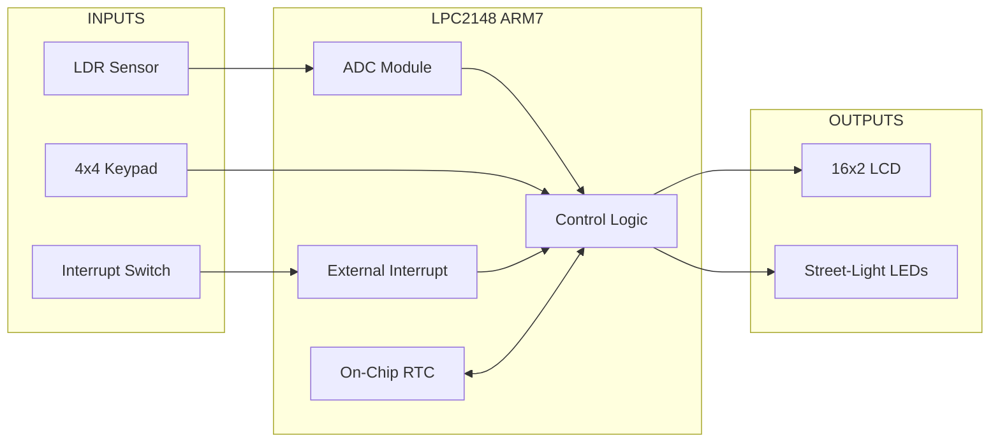

### 🧩 Functional Modules

| Module | Source File | Responsibility |
|---|---|---|
| Main Application | `main.c` | Coordinates the system and street-light decision logic |
| RTC | `rtc.c` | Reads and updates time, date and day |
| ADC | `adc.c` | Converts LDR voltage to a digital value |
| LDR / Light Status | `ldr.c` | Compares the ADC value with the threshold |
| Keypad | `kpm.c` | Scans the 4×4 keypad and reads numeric input |
| Interrupt | `interrupt.c` | Raises the menu-request flag from the switch |
| LCD | `lcd.c` | Displays clock, status and menus |
| Delay | `delay.c` | Software timing delays |

---

## 🔄 Overall Working

1. Power ON and initialize the LPC2148.
2. Initialize the LCD, RTC, ADC, keypad and external interrupt.
3. Read the current time and date from the RTC.
4. Check whether the interrupt switch has requested the configuration menu.
5. If requested, let the user edit the RTC and the street-light ON/OFF times.
6. Otherwise compare the current time with the configured schedule.
7. If the time is **outside** the interval, keep the LEDs OFF.
8. If the time is **inside** the interval, read the LDR through the ADC.
9. Compare the reading with the predefined threshold.
10. Turn the LEDs ON in darkness and OFF when light is sufficient.
11. Update the LCD and repeat.

### Overall System Flowchart

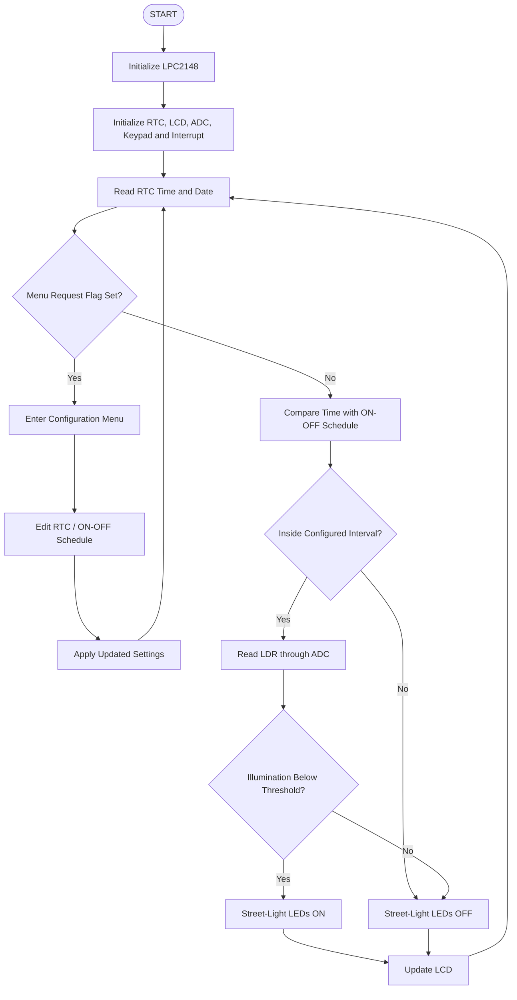

---

## 🧠 Control Logic

The LED output depends on both the RTC schedule and the ambient light.

| Time Condition | Environmental Condition | LED Output |
|---|---|---|
| Outside configured interval | Not evaluated | **OFF** |
| Inside configured interval | Dark (low illumination) | **ON** |
| Inside configured interval | Bright (sufficient illumination) | **OFF** |

### Schedule Interval Check (overnight wrap-around)

A street-light schedule normally spans midnight (for example **18:00 → 06:00**), so the interval check must handle the case where the start hour is greater than the stop hour.

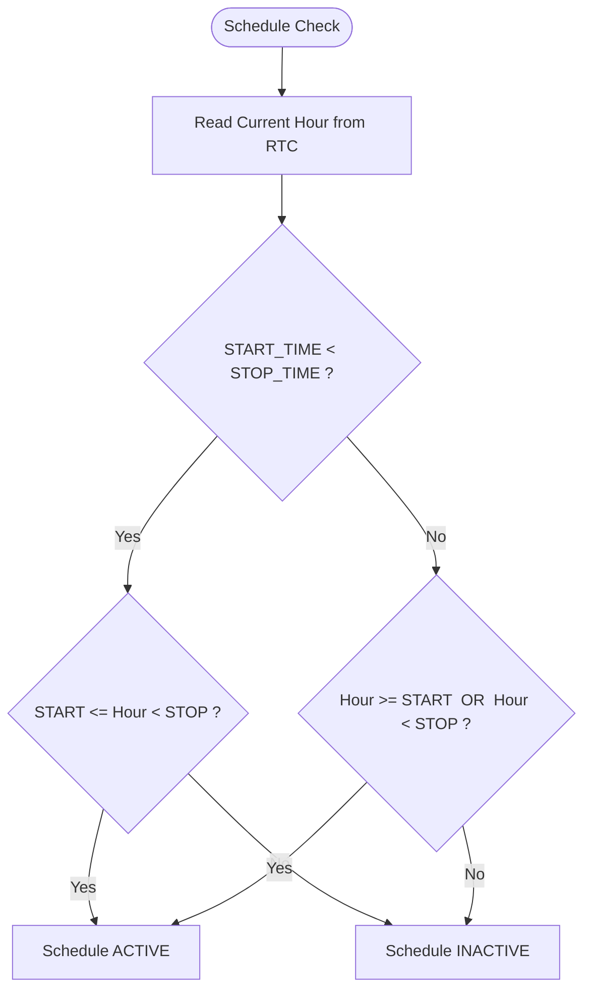

> Default firmware values: `START_TIME = 18` and `STOP_TIME = 6`. Minutes are also configurable through the menu.

---

## 🧩 Module-Wise Implementation

### 1️⃣ Main Application Module — `main.c`

**Purpose:** Coordinates every peripheral and implements the street-light decision logic.

**Working:**

1. Initialize LCD, RTC, ADC, keypad and external interrupt.
2. Read the current RTC time and date.
3. Check the volatile `menu_flag` set by the interrupt service routine.
4. If set, call the configuration routine (`EditMenu()`) and then clear the flag.
5. Compare the current time with the configured START/STOP times.
6. If the schedule is active, read the LDR status through the ADC.
7. Drive the street-light LEDs ON or OFF.
8. Refresh the LCD and loop.

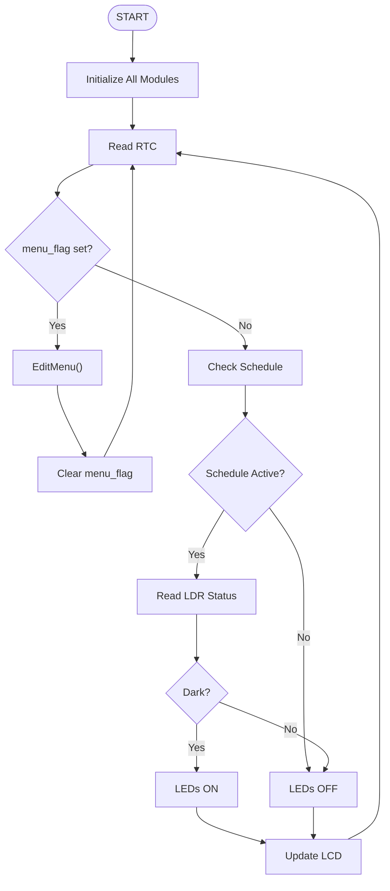

---

### 2️⃣ RTC Module — `rtc.c`

**Purpose:** Maintains and supplies the time, date and day used for scheduled operation. The on-chip RTC keeps running from its backup supply when main power is removed.

**Working:**

- Initialize the RTC peripheral (clock source, enable counters).
- Read hour, minute and second.
- Read date, month, year and day of week.
- Provide the values to the main application and LCD.
- Write new values when the user edits them from the menu.

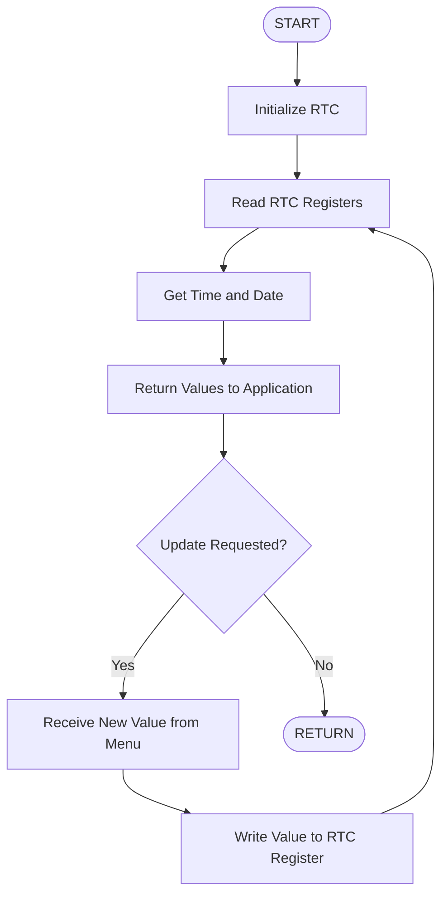

---

### 3️⃣ ADC Module — `adc.c`

**Purpose:** Converts the analog voltage of the LDR voltage-divider into a digital value.

**Working:**

1. Configure the ADC clock and the ADC input pin.
2. Select the ADC channel connected to the LDR.
3. Start conversion.
4. Wait until the conversion-done flag is set.
5. Read the digital result.
6. Return the value to the caller.

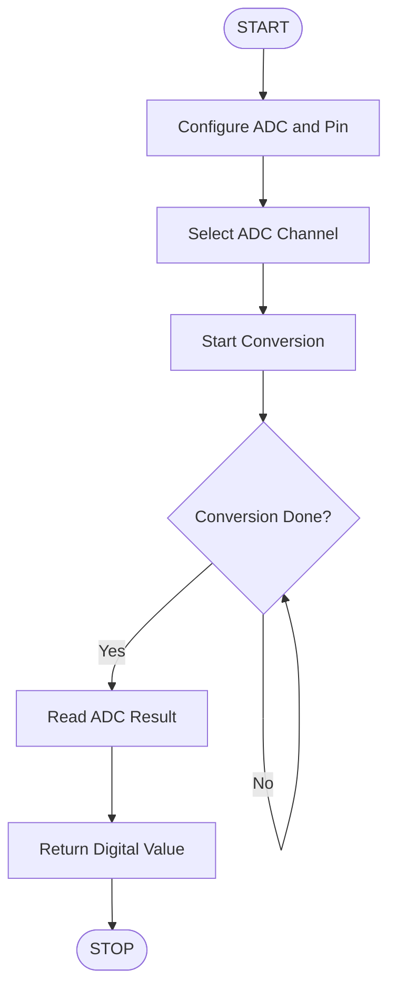

---

### 4️⃣ LDR / Light-Status Module — `ldr.c`

**Purpose:** Decides whether the surroundings are dark enough to require street lighting.

**Working:**

1. Request an ADC reading for the LDR channel.
2. Compare the value with the predefined threshold.
3. Report **DARK** or **BRIGHT** to the main application.

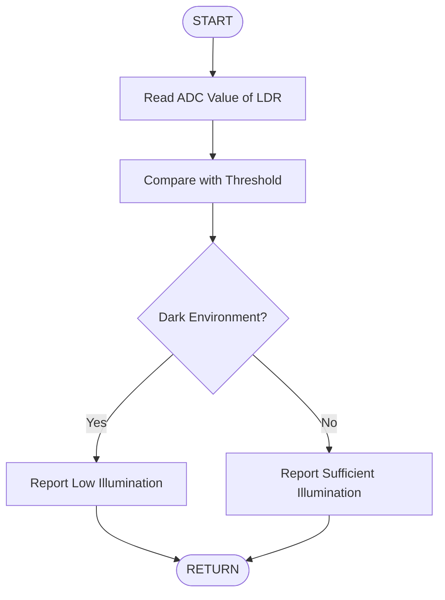

> **Note:** The comparison direction (`<` or `>`) depends on how the LDR divider is wired. Set the threshold and comparison to match your circuit.

---

### 5️⃣ Keypad Module — `kpm.c`

**Purpose:** Reads user key presses for menu navigation and numeric value entry.

**Key routines:**

| Function | Role |
|---|---|
| `InitKPM()` | Configures row/column pins |
| `Colscan()` | Checks whether any column is active (key pressed) |
| `RowCheck()` | Finds the active row |
| `ColCheck()` | Finds the active column |
| `keyscan()` | Combines row/column and looks up the key in `kpmLUT` |
| `ReadNUM()` / `ReadNUM2()` | Collect multi-digit numbers (e.g. hour, minute, year) |

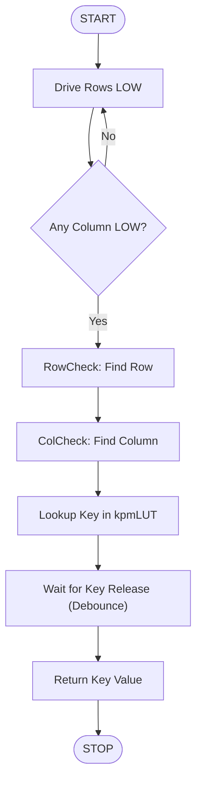

---

### 6️⃣ Interrupt Module — `interrupt.c`

**Purpose:** Handles the external interrupt generated by the switch so the user can request the configuration menu at any time.

**Working:**

1. Configure the pin as an external-interrupt input.
2. Set edge/level sensitivity and enable the interrupt in the VIC.
3. On interrupt, the ISR sets `menu_flag`.
4. The ISR clears the interrupt flag and returns.
5. The main loop detects the flag and runs the menu.

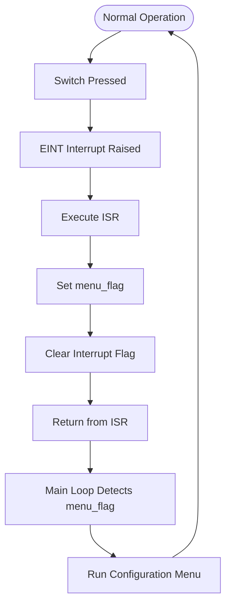

> The ISR only sets a flag. All LCD, keypad and RTC work is done in the main application, which keeps the ISR short and safe.

---

### 7️⃣ LCD Module — `lcd.c`

**Purpose:** Provides the 16×2 display interface.

**Working:**

1. Initialize the LCD (function set, display ON, clear, entry mode).
2. Send commands (`CmdLCD`) such as cursor positioning and clear.
3. Send characters and strings.
4. Display integers for time, date and ADC/status values.

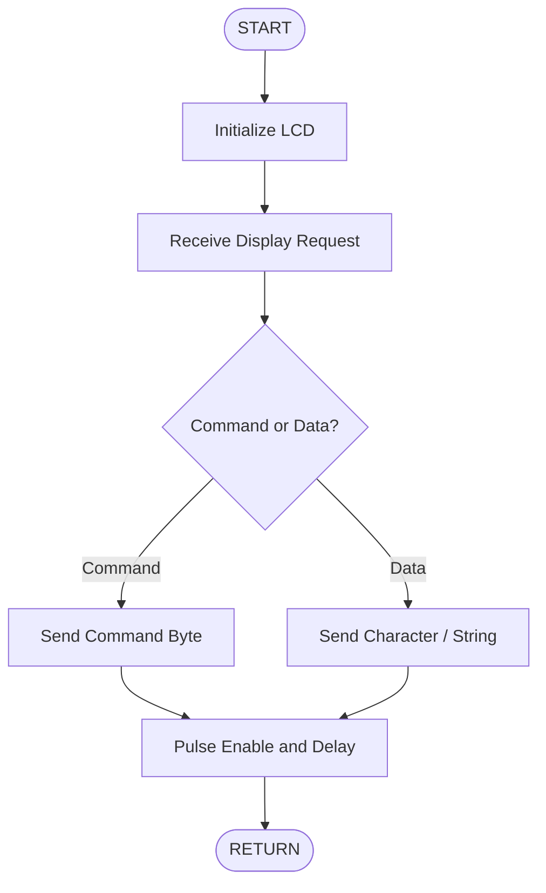

---

### 8️⃣ Delay Module — `delay.c`

**Purpose:** Provides microsecond, millisecond and second software delays used by the LCD, keypad debounce and menu timing.

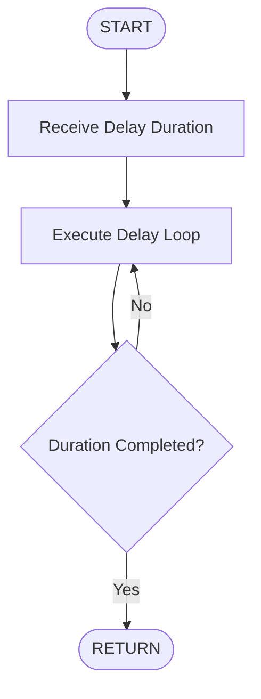

---

## ⚙️ Configuration Menu

Pressing the interrupt switch opens the menu on the LCD. The keypad selects options and enters values. If **no key is entered within the timeout period**, the system returns to the normal display.

### Menu Structure

```text
MAIN MENU
├── 1. RTC Edit
│   ├── 1. Hour
│   ├── 2. Minute
│   ├── 3. Second
│   ├── 4. Date
│   ├── 5. Month
│   ├── 6. Year
│   ├── 7. Day
│   └── 8. Exit
├── 2. Schedule Edit
│   ├── 1. ON Time   (hour, minute)
│   ├── 2. OFF Time  (hour, minute)
│   └── 3. Exit
└── 3. Exit
```

### Menu Flowchart

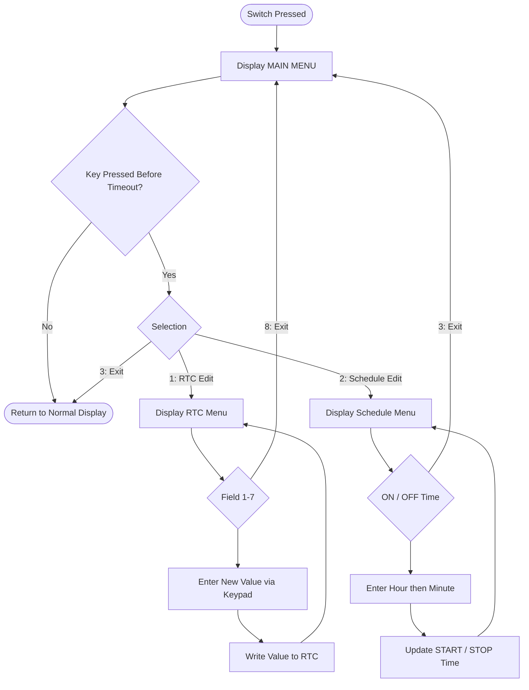

---

## 🖥️ LCD Display Layout

Normal operation screen:

```text
┌────────────────┐
│ 21:45:10       │   Line 1 : Time  (HH:MM:SS)
│ 25/11/2026  ON │   Line 2 : Date  (DD/MM/YYYY) + light status (ON/OFF)
└────────────────┘
```

---

## 🔌 Hardware Requirements

| Component | Quantity | Purpose |
|---|---:|---|
| LPC2148 ARM7 Development Board | 1 | Main controller |
| 16×2 LCD | 1 | Display |
| 4×4 Matrix Keypad | 1 | Menu navigation and value entry |
| LDR + resistor (voltage divider) | 1 | Ambient-light sensing |
| LEDs | As required | Street-light outputs |
| Push Switch | 1 | External-interrupt menu request |
| Buzzer (optional) | 1 | Audible indication |
| Backup battery (optional) | 1 | RTC backup supply |
| Power Supply | As required | System power |

### Pin Connections

> Fill this table with the exact pins used in your firmware.

| Peripheral | LPC2148 Pin(s) |
|---|---|
| LCD Data / Control | `P0.x – P0.x` |
| Keypad Rows / Columns | `P1.x – P1.x` |
| LDR (ADC channel) | `P0.x (AD0.x)` |
| Interrupt Switch | `P0.x (EINTx)` |
| Street-Light LEDs | `P0.x` |

---

## 💻 Software Requirements

| Software | Purpose |
|---|---|
| Embedded C | Firmware development |
| Keil µVision | Project development and compilation |
| ARMCC | ARM compiler toolchain |
| Flash Magic | Programming the LPC2148 |
| Git | Version control |

---

## 📂 Repository Structure

```text
Adaptive-Street-Light-Control/
│
├── README.md
├── .gitignore
│
├── Source_Code/
│   ├── Startup.s
│   ├── main.c
│   ├── rtc.c
│   ├── adc.c
│   ├── ldr.c
│   ├── kpm.c
│   ├── interrupt.c
│   ├── lcd.c
│   └── delay.c
│
│
├── Hardware/
│   ├── Block_Diagram/
│   └── Hardware_Images/
│
├── Documentation/
│   ├── Project_Report.pdf
│
├── Testing/
│   ├── Output_Screenshots/
│
└── Challenges_and_Future_Enhancements.md
```

> Adjust file names to match your actual project.

---

## 🖼️ Output Gallery

Add real photos and screenshots from your working hardware to the folders below. Do not use simulated images as proof of hardware validation.

### 🚀 System Initialization

<p align="center">
  
</p>
<p align="center"><em>LCD output during system startup.</em></p>

### ⏱️ RTC Time, Date and Light Status

<p align="center">
  
</p>
<p align="center"><em>Time, date and LDR status on the 16×2 LCD.</em></p>

### ⚙️ Configuration Menu

<table>
  <tr>
    <th align="center">Main Menu</th>
    <th align="center">RTC Edit Menu</th>
    <th align="center">Schedule Edit Menu</th>
  </tr>
  <tr>
    <td align="center"></td>
    <td align="center"></td>
    <td align="center"></td>
  </tr>
</table>

### 💡 Street Light ON / OFF Operation

<table>
  <tr>
    <th align="center">Dark → LEDs ON</th>
    <th align="center">Bright → LEDs OFF</th>
  </tr>
  <tr>
    <td align="center"></td>
    <td align="center"></td>
  </tr>
</table>

### 🔌 Hardware Setup

<p align="center">
  
</p>
<p align="center"><em>Complete LPC2148 adaptive street light hardware setup.</em></p>

---

## 🧪 Testing and Validation

| Test ID | Functionality | Expected Behaviour |
|---|---|---|
| TC01 | Power ON | LCD, RTC, ADC, keypad and interrupt initialize correctly |
| TC02 | RTC display | Current time and date shown on LCD |
| TC03 | Keypad scan | Pressed key is identified correctly |
| TC04 | Interrupt switch | Menu is requested and displayed |
| TC05 | Menu timeout | Display returns to normal if no key is entered |
| TC06 | RTC edit | Updated time/date/day values are applied |
| TC07 | Schedule edit | New ON/OFF times are stored and used |
| TC08 | LDR reading | ADC value changes with light intensity |
| TC09 | Inside schedule + dark | Street-light LEDs turn ON |
| TC10 | Inside schedule + bright | Street-light LEDs remain OFF |
| TC11 | Outside schedule | LEDs remain OFF regardless of light |
| TC12 | Overnight schedule | Interval crossing midnight (e.g. 18:00–06:00) works correctly |


---

## 🛠️ Build Instructions

1. Install Keil µVision with a compatible ARMCC toolchain.
2. Clone or download this repository.
3. Open the `Keil_Project` directory and open the `.uvproj` file.
4. Verify that **LPC2148** is selected as the target device.
5. Check source-file paths and header include paths.
6. Confirm the startup assembly file is included.
7. Select **Project → Build Target**.
8. Review the build output for errors and warnings.
9. Make sure the **HEX file** is generated (Options for Target → Output → *Create HEX File*).

---

## ⚡ Programming the Controller

1. Connect the LPC2148 board to the computer through the serial/USB interface.
2. Identify the correct COM port.
3. Open **Flash Magic** and select the LPC2148 device.
4. Set the baud rate and bootloader (ISP) options for your board.
5. Select the generated HEX file.
6. Program the microcontroller.
7. Reset the board and observe the display and LEDs.

---

## 🧩 Challenges and Solutions

| Area | Development Consideration |
|---|---|
| RTC + Interrupt Integration | Keeping RTC reads/updates reliable while the external interrupt is enabled |
| ISR Design | Keeping the ISR short (set flag only) and doing work in the main loop |
| Keypad Scanning | Row/column scanning, debounce and multi-digit entry |
| LDR Threshold | Choosing a threshold that matches the divider circuit and lighting conditions |
| Schedule Wrap-Around | Handling intervals that cross midnight |
| Menu Timeout | Returning to display when no input is received |

For each real issue, record: **problem → root cause → debugging approach → solution → final verification**.

---

## 🚀 Future Enhancements

The following are possible improvements and are **not** claimed as implemented:

- Wireless monitoring and remote schedule configuration.
- Multiple street-light zone control.
- Energy consumption monitoring.
- Fault detection and reporting.
- Non-volatile storage for user-configured settings.
- Hysteresis on the LDR threshold to avoid flicker at dusk/dawn.
- Automatic dimming (PWM) based on illumination level.

---

## 🏢 Applications

- Smart-city street lighting.
- Residential streets.
- College and university campuses.
- Parking areas.
- Industrial outdoor lighting.
- Public pathways and roads.

---

## 👨‍💻 Author

**Name:** `<Lalitha>`
**E-Mail:** `<pandranki.lalitha44@gmail.com>`
**GitHub:** `<https://github.com/pandrankilalitha44>`

**Adaptive Street Light Control Using Time and Environmental Illumination**

**Controller:** LPC2148 ARM7 Microcontroller
**Programming Language:** Embedded C
**Development Environment:** Keil µVision
**Programming Tool:** Flash Magic

---

<p align="center">
  <strong>💡 Adaptive Street Light Control</strong>
  <br>
  <em>Right Light. Right Time. Less Energy.</em>
</p>

---

### 📌 Project Documentation Note

This README describes the documented architecture and intended operation. Actual hardware behaviour, pin assignments and test results should be verified against the firmware, circuit and recorded validation evidence.
